# Alloy2D

<p align="center">
  <strong>The Alloy of React & Pixi.js for Cross-Platform Mini-Games</strong>
</p>

<p align="center">
  
  
  
  
  
  
</p>

---

## 📖 什么是 Alloy2D？

**Alloy2D** 是一款面向现代多端（Web 移动端/桌面端、微信小游戏、Electron）的高性能 2D 混合小游戏引擎。

正如其名 **“Alloy（合金）”** —— 它将 **React 的声明式组件化与状态管理生态** 与 **Pixi.js 的极致 WebGL 2D 渲染管线** 深度熔合，既保留了 React 开发复杂游戏 HUD、商城、排行榜、弹窗业务的极高研发人效，又拥有原生 WebGL 60FPS 的丝滑粒子与动画表现，彻底摆脱纯 Web 渲染的性能瓶颈与纯 Canvas 引擎编写复杂 UI 的冗繁代码。

---

## ⚡ 核心架构与设计

```mermaid
flowchart TD
    subgraph UI_Layer["React 18 声明式 UI 层 (Web / Desktop)"]
        ReactHUD["游戏 HUD / 金币 / 关卡进度"]
        ReactModals["商城 / 排行榜 / 设置模态弹窗"]
        ZustandStore["Zustand 全局轻量状态树"]
    end

    subgraph Sync_Engine["Alloy2D 同步与事件中枢"]
        DirtySync["DirtyStateSync 脏标记按需同步"]
        EventBus["EventBus 全局事件管道"]
    end

    subgraph Render_Layer["Pixi.js v7 渲染管线 (双端通用)"]
        SceneMgr["SceneManager 场景管理器"]
        Board["游戏主棋盘 / 实体渲染 Container"]
        EffectMgr["EffectManager (对象池复用 粒子+飘字)"]
        TweenMgr["TweenManager 补间缓动动画"]
    end

    subgraph Native_Wx["微信小游戏端专属 (无 DOM 环境)"]
        CanvasKit["Canvas UI Kit (Button / Panel / Modal)"]
        WxAdapter["PlatformAdapter (SafeArea / Audio / Storage)"]
        WxBoot["bootstrapWxGame 通用启动器"]
    end

    ZustandStore <-->|单向数据流与脏标记| DirtySync
    DirtySync -->|批量同步| Render_Layer
    EventBus <-->|低耦合通信| UI_Layer
    EventBus <-->|低耦合通信| Render_Layer

    Render_Layer --> WxAdapter
    CanvasKit --> WxAdapter
```



---

## 🌟 核心特性

- 🚀 **声明式 + 原生渲染混合**：React 负责复杂 UI，Pixi.js 负责主游戏舞台，通过 `DirtyStateSync` 按需同步，无无效重渲染。
- 📱 **多端全覆盖**：无缝运行于 **Web 移动端/PC 浏览器**、**微信小游戏 (WeChat Mini-Game)** 与 **Electron 桌面端**。
- 🎵 **跨端统一音频系统 (AudioManager)**：
  - 音效按名注册，Web (`HTMLAudioElement`) 与微信小游戏 (`InnerAudioContext`) 双后端自动切换。
  - 音频资源缺失时自动回退为 WebAudio 振荡器程序化合成音，保证**零延迟、零闪退**。
  - BGM 支持循环、音量淡入淡出、切后台自动静音与前台唤醒恢复。
- 💥 **低 GC 粒子与文字特效 (EffectManager)**：
  - 基于高复用率 `Pool<T>` 对象池，彻底避免移动端高频 GC 引起的掉帧卡顿。
  - 内置粒子爆裂衰减与浮动文字弹性动效。
- 🖐️ **手势与坐标系统 (InputManager)**：
  - 屏幕物理像素与设计分辨率坐标双向精准转换（支持刘海屏与居中留白计算）。
  - 内置 Tap、DoubleTap、LongPress、Swipe（带速度方向）、Drag（增量与累计位移）手势识别。
- 💾 **类型化持久化存档 (SaveManager)**：
  - 支持版本迁移链（Schema Migrations），老版本用户存档无感升级。
  - 具备脏数据熔断保护，防止因存储损坏导致游戏起动崩溃。
- 🎨 **小游戏原生组件库 (Canvas UI Kit)**：
  - 微信环境无 DOM 也能快速搭建精美 UI：`CanvasButton`（按压缩放/音效联动）、`CanvasPanel`（圆角卡片）、`CanvasModal`（全屏遮罩/入场缓动）。
- 🛠 **开箱即用脚手架 (CLI)**：一条命令创建新游戏工程，一键编译导出符合微信规范的完整工程包。

---

## 🎮 落地游戏范例

仓库内内置两款基于 Alloy2D 开发的完整小游戏工程：

| 游戏工程 | 玩法类型 | 技术亮点 |
| :--- | :--- | :--- |
| **[星耀三消](games/star-match3)** (`@alloy2d/star-match3`) | 经典三消策略益智 | 8×8 动态掉落填充、特殊炸弹消除、连击特效、道具商城、实时排行榜 |
| **[羊了个羊](games/yang-sheep)** (`@alloy2d/yang-sheep`) | 3D 层叠消除卡牌 | 复杂多层遮挡阴影计算、7 卡槽消除判定、移出/撤回/洗牌道具、过关结算 |

---

## 🚀 快速开始

### 1. 环境准备
- Node.js >= 18.0.0
- npm >= 9.0.0

### 2. 克隆与安装依赖
```bash
git clone https://github.com/javanokia/Alloy2D.git
cd Alloy2D
npm install
```

### 3. 本地启动开发
```bash
# 启动《星耀三消》Web 端
npm run dev

# 启动《羊了个羊》Web 端
npm run dev:yang
```
浏览器打开 `http://localhost:5173` 即可实时体验与热重载开发。

### 4. 自动化测试与类型检查
```bash
# 执行 58 项单元测试套件
npm test

# 全局 TypeScript 严格静态检查
npm run typecheck
```

### 5. 编译构建
```bash
# 构建引擎库核心 (输出 packages/hybrid-engine/dist/)
npm run build:engine

# 构建双游戏 Web 端生产产物 (输出 games/*/dist/)
npm run build:game

# 编译并导出微信小游戏项目 (输出 games/*/dist-wx/)
npm run build:wx
```

---

## 📲 导入微信开发者工具

运行 `npm run build:wx` 后，直接打开 **微信开发者工具**：
1. 选择 **导入项目**。
2. 项目目录选择 `games/star-match3/dist-wx` 或 `games/yang-sheep/dist-wx`。
3. AppID 可使用测试号，直接真机预览或在模拟器运行！

> 📊 **首包体积表现**：首包总大小约 **2.85 MB**（包含完整引擎、游戏代码、图集与全部音效音频），远低于微信小游戏官方 **4.00 MB** 限制。

---

## 🛠 脚手架 CLI 使用

Alloy2D 内置了脚手架工具 `hybrid-engine`：

```bash
# 基于 Alloy2D 快速初始化一个全新游戏工程
npm run create-game my-new-game

# 在特定游戏工程目录下导出微信小游戏
npx hybrid-engine export-wx
```

---

## 📁 目录架构

```text
Alloy2D/
├── packages/
│   └── alloy2d/                # Alloy2D 核心引擎库 (`alloy2d`)
│       ├── src/
│       │   ├── audio/          # 跨端音频管理器与合成音 (AudioManager)
│       │   ├── effects/        # 对象池与特效管理 (EffectManager)
│       │   ├── input/          # 输入与手势系统 (InputManager)
│       │   ├── storage/        # 持久化存档与迁移 (SaveManager)
│       │   ├── ui/             # 微信 Canvas 原生组件库 (Canvas UI Kit)
│       │   ├── core/           # 场景管理、脏标记同步、安全区计算
│       │   ├── platform/       # 多端适配层与微信通用启动器
│       │   └── react/          # React Canvas 宿主与调试遥测 Dock 面板
│       └── bin/cli.mjs         # 引擎脚手架 CLI (create / export-wx)
├── games/
│   ├── star-match3/            # 落地实战 1：《星耀三消》双端游戏工程 (@alloy2d/star-match3)
│   └── yang-sheep/             # 落地实战 2：《羊了个羊》双端游戏工程 (@alloy2d/yang-sheep)
├── docs/
│   └── architecture.md         # 混合架构深度白皮书与跨端技术复盘
├── .github/                    # GitHub Actions CI 工作流与社区模版
├── LICENSE                     # MIT 开源协议
└── package.json                # Monorepo 统一工作区配置
```

---

## 📚 深度技术白皮书

想深入了解 React 与 Pixi.js 是如何解决状态重渲染损耗、实现 60FPS 丝滑通信与微信环境无缝抹平的？请阅读：
👉 **[React+Pixi.js 混合架构技术白皮书与跨端复盘](docs/architecture.md)**

---

## 🤝 贡献指南 (Contributing)

欢迎提交 Issue 和 Pull Request！详细规范请查阅 [CONTRIBUTING.md](CONTRIBUTING.md) 与 [Code of Conduct](CODE_OF_CONDUCT.md)。

---

## ⚠️ 素材声明与免责条款 (Assets Disclaimer)

本项目**核心代码库与工程逻辑基于 MIT License 开源**。仓库内包含的音频片段（MP3）及游戏美术贴图（星耀三消宝石、羊了个羊卡牌等）仅用于**开源技术交流、学习与架构演示**。商业发布或二次上线前，请替换为您拥有完整商用版权的素材资源。

---

## 📄 开源许可证

本项目基于 [MIT License](LICENSE) 开源。
